# 3D CHPP Process Simulation & General Arrangement (GA) Digital Twin

**Document ID:** `docs/scada/05-3d-chpp-process-simulation.md`  
**Scope:** Coal Handling & Preparation Plant (CHPP) 3D Digital Twin (Stages 1–6 Comminution/Screening + Dense-Medium Wash Plant & Medium Recovery)  
**Primary Code Modules:**
- `ArchScada/ArchScada.Desktop/Controls/ThreeD/Plant3DSceneData.cs`
- `ArchScada/ArchScada.Desktop/Controls/ThreeD/Plant3DOpenGlCanvas.cs`
- `ArchScada/ArchScada.Desktop/Controls/Plant3DViewportControl.cs`
- `ArchScada/ArchScada.Desktop/ViewModels/MainShellViewModel.cs`
- `ArchScada/ArchScada.Desktop/Views/MainShellView.axaml`
- `ArchScada/ArchScada.Unity/Assets/Editor/ArchScadaSceneBuilder.cs`

---

## Deliverable 1 — Existing 3D Implementation Audit

An audit of the prior 3D implementation (`Plant3DSceneData.cs`, `Plant3DOpenGlCanvas.cs`, `Plant3DViewportControl.cs`) identified the following engineering and simulation gaps relative to the plant General Arrangement (GA) drawing:

1. **Disconnected Arbitrary Layout (14 Legacy Nodes vs. 29 GA Nodes):**
   - The previous scene placed 14 equipment assets on arbitrary local coordinates (`CR-101` at `(-7.5, -2.5)`, `SC-102` at `(-1.3, -2.5)`, `TK-201` at `(1.2, 3.2)`) that did not match the spatial arrangement of the GA drawing (`X` West-to-East, `Z` North-to-South).
   - Entire Stages 1–5 and key Wash Plant units were absent: ROM Raw Coal Stockpile (`SP-001`), Front-End Wheel Loader (`FEL-101`), Receiving Feeder Bin & Ramp (`BN-101`), Primary Vibro Grizzly Feeder (`VF-101`), Double Roller Crusher (`DRC-101`), Plant Feed Surge Bin (`BN-201`), Desliming Screen (`DS-201`), Integrated Dense-Medium Wash Plant Module (`WP-301`), and Clean/Discard Stockpiles (`SP-301`, `SP-302`).
2. **Non-Industrial Conveyor Geometry & Missing Chute Coupling:**
   - Conveyors (`CV-101`, `CV-102`) were previously represented as two fixed-length `conveyor_segment.glb` boxes floating near the ground (`Y = 0.1`), lacking vertical structural trestle bents to `Y = 0`, side stringers, maintenance walkways, handrails, rotating head/tail pulleys, drive gearboxes, skirtboard hoppers, and enclosed transfer chutes.
   - Because transfer chutes were absent, coal particles appeared to jump across empty air gaps rather than dropping cleanly into crusher/screen/bin feed openings.
   - Individual conveyors could not be raycast-picked or inspected in the UI.
3. **Lack of Mechanical Equipment Kinematics & Coupled Upstream-Downstream Flow:**
   - `FEL-101` had no articulated 4-stage stockpile-to-ramp loading cycle.
   - `JC-101` lacked rotating dual flywheels and a reciprocating swing jaw; `DRC-101` lacked counter-rotating toothed crushing rollers.
   - Flow particle speeds were evaluated strictly from a single local equipment item (`GetFlowSpeedFactor`), so stopping an upstream feeder or crusher did not starve downstream conveyors and screens.
4. **Viewport Framing, Pan Limits, and Inspector Metadata:**
   - Hardcoded pan clamps (`X in [-14, 14]`, `Z in [-12, 12]`) prevented operators from panning to North (`TK-201` at `Z = -15.8`) and South (`SP-001` at `Z = 13.8`) GA extremes.
   - Selecting an asset only displayed basic SCADA name/status/kW without GA label, process stage, dimensions, mechanical operating principle, or upstream-to-downstream connectivity.

---

## Deliverable 2 — Industrial Equipment Research & Identification Report

Every machine and conveyor in the GA drawing is modeled as an individually selectable, focusable `Plant3DNode` in `Plant3DSceneData.cs` with `+X` forward orientation in glTF rotated by `YawDegrees` around `+Y` (`Y = 0` ground plane, `X` = West(-) to East(+), `Z` = North(-) to South(+)).

### 2.1 Process Equipment Nodes (18 Machines)

| Tag | Exact GA Label | Process Stage | GLB Asset | World Pos `(X, Y, Z)` m | Yaw | Nominal Dimensions / Spec | Mechanical Operating Principle | Linked SCADA ID |
|---|---|---|---|---|---:|---|---|---|
| `SP-001` | ROM Raw Coal Stockpile | Stage 1 — ROM Reception | `stockpile_cone.glb` | `(-13.8, 0.0, 13.8)` | `0°` | Ø 16 m × 5.2 m cone (0–300 mm ROM) | Bulk unscreened coal reserve reclaimed by front-end wheel loader bucket cycles. | `AF-001` |
| `FEL-101` | Front-End Wheel Loader | Stage 1 — ROM Reception | `wheel_loader_chassis.glb` + `wheel_loader_bucket.glb` | `(-13.8, 0.0, 11.8)` | `90°` (dynamic) | 3.4 m × 1.9 m × 2.4 m · 4.5 m³ bucket | 4-stage cycle: scoop at `SP-001` (`Z=12.6`), climb `BN-101` ramp (`Z=10.1, Y=0.85`), lift boom (`0°→38°`), dump (`0°→-58°`), reverse. | `AF-001` |
| `BN-101` | Feeder Bin / Receiving Hopper | Stage 1 — ROM Reception | `feeder_bin_bn101.glb` | `(-13.8, 0.0, 8.8)` | `90°` (RH glTF; `-90°` LH Unity) | 4.0 m × 3.6 m × 3.2 m · 45 t surge | Gravity surge hopper with inclined ramp facing South (`+Z`) toward loader and live fill-level pulse during dumps. | `AF-001` |
| `VF-101` | Primary Vibro Grizzly Feeder | Stage 2 — Initial Separation | `vibro_feeder_vf101.glb` | `(-13.8, 0.2, 6.2)` | `90°` | 3.2 m × 1.8 m × 1.7 m · 75 mm aperture | Dual unbalanced eccentric motors impart linear throw: scalps `<75 mm` onto `CV-102` (Path B) and feeds `+75 mm` onto `CV-101` (Path A). | `AF-001` |
| `JC-101` | Primary Jaw Crusher | Stage 3 — Jaw Crushing | `jaw_crusher_jc101.glb` | `(-13.8, 0.0, -0.6)` | `0°` | 3.1 m × 2.6 m × 3.0 m · CSS 110 mm · 315 kW | Dual rotating side flywheels (`r=0.58 m`) and eccentric toggle shaft reciprocate corrugated swing jaw (`~4.5 Hz`) to crush `+75 mm` coal `<110 mm`. | `CR-101` |
| `DRC-101` | Double Roller Crusher & Surge Hopper | Stage 4 — Double Roll Crushing | `double_roll_crusher_drc101.glb` | `(-7.2, 0.0, -0.6)` | `0°` | 2.8 m × 2.4 m × 3.2 m · Ø 760 mm rolls | Two counter-rotating horizontal toothed cylinders (`r=0.38 m, L=1.3 m`, `±angle`) nip and shear `+50 mm` recirculated oversize with low fines generation. | `CR-101` |
| `SS-101` | Central Multi-Deck Sizing Screen | Stage 6 — Central Sizing Screen | `central_sizing_screen_ss101.glb` | `(0.2, 0.0, 0.5)` | `0°` | 4.4 m × 2.8 m × 3.7 m · 50 mm / 6 mm decks | High-amplitude vibrating screen classifying converged streams (`CV-102` + `CV-104`) into `+50 mm` oversize (`CV-106`), `6–50 mm` plant feed (`CV-201`), and `<6 mm` fines (`CV-105`). | `SC-102` |
| `BN-201` | Plant Feed Surge Bin | Wash Plant & Medium Recovery | `surge_bin_bn201.glb` | `(11.8, 0.0, -0.8)` | `0°` | 3.0 m × 3.0 m × 3.9 m · 60 t surge | Elevated conical-bottom surge bin buffering dry screening output ahead of metered wet washing feed (`CV-202`). | `SL-601` |
| `DS-201` | Desliming Screen & Vibro Feeder | Wash Plant & Medium Recovery | `desliming_screen_ds201.glb` | `(8.8, 0.0, -9.8)` | `180°` | 3.5 m × 2.4 m × 2.8 m · 0.5 mm wedge-wire | High-G vibrating screen with water sprays stripping `<0.5 mm` slimes prior to dense-medium separation to prevent magnetite viscosity buildup. | `SC-102` |
| `WP-301` | Dense-Medium Wash Plant, Cyclone, Dewatering Screen, Control Room & MCC | Wash Plant & Medium Recovery | `wash_plant_module_wp301.glb` | `(-0.8, 0.0, -7.8)` | `0°` | 6.8 m × 4.4 m × 4.7 m multi-level module | Integrated DMC module separating clean coal overflow (`CV-301`) from high-ash shale sinks (`CV-302`) at SG `1.52`, with drain-and-rinse dewatering and elevated MCC/CCR. | `DM-301` |
| `MS-301` | Wet-Drum Magnetic Separator (Macsep) | Wash Plant & Medium Recovery | `magnetic_separator_ms301.glb` | `(-1.6, 0.0, -11.4)` | `0°` | 2.2 m × 1.8 m × 2.0 m · 96.4% recovery | Rotating permanent-magnet drum recovers ferromagnetic magnetite from dilute rinse effluent back to `TK-301`. | `MS-301` |
| `TK-301` | Magnetite Medium Tank | Wash Plant & Medium Recovery | `magnetite_tank_tk301.glb` | `(-5.4, 0.0, -12.0)` | `0°` | Ø 2.9 m × 3.4 m · SG 1.52 controlled | Agitated correct-medium sump tank blending recovered magnetite and clarified water to feed `WP-301`. | `TK-301` |
| `TK-201` | High-Rate Thickener | Wash Plant & Medium Recovery | `thickener_tk201.glb` | `(-1.2, 0.0, -15.8)` | `0°` | Ø 5.7 m × 2.6 m · flocculated clarifier | Slowly rotating central rake mechanism consolidates fine tailings to underflow cone while clarified water overflows peripheral launder (`87.4%` recovery). | `TK-201` |
| `PP-201` | Underflow Pump A (Duty) | Wash Plant & Medium Recovery | `centrifugal_pump.glb` | `(-4.6, 0.0, -15.0)` | `0°` | 1.6 m × 1.2 m × 1.4 m · 385 m³/h @ 4.2 bar | Rubber-lined centrifugal slurry pump handling `TK-201` underflow. | `PP-201` |
| `PP-202` | Underflow Pump B (Standby) | Wash Plant & Medium Recovery | `centrifugal_pump.glb` | `(-4.6, 0.0, -16.3)` | `0°` | 1.6 m × 1.2 m × 1.4 m · Standby | Hot-standby parallel centrifugal pump for `PP-201`. | `PP-202` |
| `PP-203` | Flocculant & Clarified Water Pump | Wash Plant & Medium Recovery | `centrifugal_pump.glb` | `(2.2, 0.0, -15.0)` | `180°` | 1.5 m × 1.1 m × 1.3 m · 24.5 L/min | Metered flocculant dosing and clarified process water return pump. | `PP-203` |
| `SP-301` | Clean Product Coal Stockpile | Wash Plant & Medium Recovery | `stockpile_cone.glb` | `(-9.8, 0.0, -5.2)` | `0°` | Ø 14 m × 4.6 m · 9.4% ash | Washed clean coal product reserve stacked by `CV-301`. | `SL-601` |
| `SP-302` | Discard / Refuse Stockpile | Wash Plant & Medium Recovery | `stockpile_cone.glb` | `(-10.6, 0.0, -8.2)` | `0°` | Ø 12 m × 4.0 m · Shale reject | Dense-medium cyclone sinks rock/shale reject stacked by `CV-302`. | `CV-501` |

### 2.2 Procedural Industrial Belt Conveyors (11 Conveyors)

All 11 conveyors are built procedurally from `TailPos → HeadPos` with steel side stringers, cross-bracing, vertical support trestles grounded at `Y = 0`, maintenance walkways & safety-yellow handrails, rotating head/tail pulleys, drive gearboxes, skirtboard hoppers, enclosed transfer chutes, moving cleats, and material-classed coal streams.

| Tag | Exact GA Label | Process Stage | Tail `(X, Y, Z)` | Head `(X, Y, Z)` | Material Class | Linked SCADA ID |
|---|---|---|---|---|---|---|
| `CV-101` | `Jaw feed conv` | Stage 2 — Initial Separation | `(-13.8, 0.85, 5.4)` | `(-13.8, 3.55, 0.8)` | `RawRom` (`+75 mm`) | `CV-101` |
| `CV-102` | `Under size conv` | Stage 2 — Initial Separation | `(-12.8, 0.65, 6.1)` | `(-1.9, 4.15, 1.15)` | `ScalpedUndersize` (`<75 mm`) | `CV-102` |
| `CV-103` | `Sizing screen feed` | Stage 3 — Jaw Crushing | `(-12.5, 0.75, -0.6)` | `(-8.3, 2.75, -0.6)` | `CrushedPrimary` (`<110 mm`) | `CV-101` |
| `CV-106` | `Oversize conv` | Stage 4 — Double Roll Crushing | `(1.8, 2.55, -1.8)` | `(-7.2, 4.35, -1.8)` | `ScreenOversize` (`+50 mm`) | `CV-102` |
| `CV-104` | `Sizing screen feed conv` | Stage 5 — Secondary Transfer | `(-6.3, 0.80, -0.4)` | `(-1.9, 4.20, 0.15)` | `CrushedRoll` (`<50 mm`) | `CV-101` |
| `CV-105` | `Fines conv under the sizing screen` | Stage 6 — Central Sizing Screen | `(-1.2, 0.55, 0.5)` | `(2.8, 1.15, 2.2)` | `SizedFines` (`<6 mm`) | `CV-102` |
| `CV-201` | `Plant feed conv` | Stage 6 — Central Sizing Screen | `(2.3, 1.45, 0.4)` | `(10.6, 4.25, -0.8)` | `PlantFeed` (`6–50 mm`) | `CV-101` |
| `CV-202` | `Desliming screen feed` | Wash Plant & Medium Recovery | `(11.4, 0.85, -1.9)` | `(9.6, 3.95, -8.6)` | `PlantFeed` (`6–50 mm`) | `CV-101` |
| `CV-203` | `Cyclone feed conv` | Wash Plant & Medium Recovery | `(7.2, 1.85, -9.6)` | `(2.6, 3.65, -8.1)` | `DeslimedCoal` (`+0.5 mm`) | `DM-301` |
| `CV-301` | `Product conv` | Wash Plant & Medium Recovery | `(-4.2, 2.10, -6.8)` | `(-8.8, 2.65, -5.4)` | `CleanProduct` | `CV-102` |
| `CV-302` | `discard conv` | Wash Plant & Medium Recovery | `(-4.4, 2.05, -8.4)` | `(-9.6, 2.55, -8.2)` | `RefuseDiscard` | `CV-501` |

---

## Deliverable 3 — Process-Flow & Conveyor Connectivity Diagram

```mermaid
flowchart LR
    subgraph S1["Stage 1 — ROM Reception"]
        SP001["SP-001: ROM Raw Coal Stockpile"] -->|"Wheel Loader Scoop"| FEL101["FEL-101: Front-End Wheel Loader"]
        FEL101 -->|"Ramp Dump (Z=10.1, Y=0.85)"| BN101["BN-101: Feeder Bin / Hopper"]
    end

    subgraph S2["Stage 2 — Initial Separation (75 mm Grizzly)"]
        BN101 -->|"Gravity Throat"| VF101["VF-101: Primary Vibro Grizzly Feeder"]
        VF101 -->|"Path A: +75 mm Oversize"| CV101["CV-101: Jaw feed conv"]
        VF101 -->|"Path B: <75 mm Undersize"| CV102["CV-102: Under size conv"]
    end

    subgraph S3["Stage 3 — Jaw Crushing"]
        CV101 -->|"Head Chute"| JC101["JC-101: Primary Jaw Crusher"]
        JC101 -->|"Discharge (<110 mm)"| CV103["CV-103: Sizing screen feed"]
    end

    subgraph S45["Stages 4–5 — Double Roll Crushing & Transfer"]
        CV103 -->|"Bypass / Transfer Chute"| DRC101["DRC-101: Double Roller Crusher & Surge Hopper"]
        DRC101 -->|"Secondary Discharge"| CV104["CV-104: Sizing screen feed conv"]
    end

    subgraph S6["Stage 6 — Central Multi-Deck Sizing Screen"]
        CV102 -->|"Dual Feed Box (Stream #1)"| SS101["SS-101: Central Multi-Deck Sizing Screen"]
        CV104 -->|"Dual Feed Box (Stream #2)"| SS101
        SS101 -->|"+50 mm Top-Deck Curved Chute"| CV106["CV-106: Oversize conv"]
        CV106 -->|"Closed-Circuit Return"| DRC101
        SS101 -->|"<6 mm Under-Pan Fines"| CV105["CV-105: Fines conv under sizing screen"]
        SS101 -->|"6–50 mm Middlings"| CV201["CV-201: Plant feed conv"]
    end

    subgraph WP["Wash Plant, Dense-Medium Cyclone & Thickener"]
        CV201 --> BN201["BN-201: Plant Feed Surge Bin"]
        BN201 --> CV202["CV-202: Desliming screen feed"]
        CV202 --> DS201["DS-201: Desliming Screen (0.5 mm)"]
        DS201 --> CV203["CV-203: Cyclone feed conv"]
        CV203 --> WP301["WP-301: Dense-Medium Wash Plant & MCC"]
        WP301 -->|"Clean Coal Overflow"| CV301["CV-301: Product conv"] --> SP301["SP-301: Clean Product Stockpile"]
        WP301 -->|"Shale Sinks Reject"| CV302["CV-302: discard conv"] --> SP302["SP-302: Discard / Refuse Stockpile"]
        WP301 -->|"Dilute Rinse Medium"| MS301["MS-301: Wet-Drum Macsep"]
        MS301 -->|"Recovered Magnetite"| TK301["TK-301: Magnetite Medium Tank"]
        TK301 -->|"SG 1.52 Medium"| WP301
        WP301 -->|"Slimes Effluent"| TK201["TK-201: High-Rate Thickener"]
        TK201 -->|"Underflow Slurry"| PP201["PP-201 / PP-202: Underflow Pumps"] --> TK301
        TK201 -->|"Clarified Return"| PP203["PP-203: Flocculant & Return Pump"] --> WP301
    end
```

---

## Deliverable 7 — Architecture & Performance Design

### 7.1 Dual-Path Rendering Architecture
1. **Primary Hardware Pipeline (`Plant3DOpenGlCanvas` — OpenGL 3.3 Core / OpenGL ES 3.0):**
   - **GLB PBR Asset Ingestion (`GlbMeshLoader`):** Zero-dependency binary glTF 2.0 parser flattening node hierarchies into an interleaved `11-float` vertex format (`pos3 + normal3 + rgb3 + metallic1 + roughness1`), uploaded once per mesh to static GPU VAOs/VBOs/EBOs.
   - **Static Batched Procedural Structures:** All 11 conveyor frames, side stringers, cross-bracing, grounded trestle bents, walkways, handrails, skirtboard hoppers, head motors, enclosed transfer chutes, and the curved `SS-101 → CV-106` oversize chute are compiled into a single static indexed GPU mesh (`_conveyorStructureMesh`) during `OnOpenGlInit`, minimizing per-frame draw calls. Similarly, all slurry/magnetite pipes are batched into `_pipesMesh`.
   - **Dynamic Per-Frame Mechanics:** Only dynamic sub-assemblies (`FEL-101` articulated chassis + boom/bucket + coal dump stream, `JC-101` flywheels + 4.5 Hz swing jaw, `DRC-101` counter-rotating toothed rollers, conveyor head/tail pulleys, belt cleats, coal stream parcels, and flow direction chevrons) emit lightweight transform matrices per frame.
2. **Pure-Avalonia Software Fallback (`HudOverlayControl.RenderSoftwareFallback`):**
   - Automatically engages when OpenGL is unavailable (e.g., headless CI, software VMs, or remote desktop sessions without GL acceleration).
   - Shares the exact same `Plant3DSceneData` projection matrices (`BuildCameraMatrices`), `ComputeLoaderPose`, `EvaluateProcessFlows`, procedural conveyor geometry, and triangle depth-sorting.
3. **3D Picking & Label Decluttering:**
   - Machine picking uses world-space `Ray-AABB` intersection (dynamically tracking `FEL-101`'s live `ChassisPosition`).
   - Conveyor picking uses `Ray-Segment Capsule` intersection (`RayIntersectsSegmentCapsule`) along each belt's `TailPos → HeadPos` centerline so long diagonal conveyors (`CV-102`, `CV-201`, `CV-202`) never hijack clicks on equipment located underneath them.
   - Floating HUD labels apply priority sorting (Selected → Hovered → Machines/Alarms → Conveyors) with collision nudging so tags remain readable across zoom levels.
4. **Coupled Upstream-to-Downstream Flow Solver (`EvaluateProcessFlows`):**
   - Performs 4 iterative relaxation passes over the directed plant graph (including the `SS-101 → CV-106 → DRC-101 → CV-104 → SS-101` closed-circuit loop) using live `EquipmentItem` status and `LoadPercent` from `SimulatedTelemetryService` without modifying the 23 core SCADA equipment items.

### 7.2 Unity Digital Twin Sync (`ArchScadaSceneBuilder.cs`)
- `ArchScadaSceneBuilder` mirrors the exact 18-machine + 11-conveyor GA coordinates, GLB asset list, 9 engineering camera presets, and `LinkedScadaId` bindings into `CoalPlantTwin.unity` for external Unity runtime visualization over UDP (`127.0.0.1:17850`).

### 7.3 Build, Test & Runtime Verification Evidence
- **Blender Headless Asset Pipeline (`generate_plant_assets.py`):** Executed via Blender 5.2.2 LTS, exporting **22 PBR `.glb` industrial equipment models** (`wheel_loader_chassis.glb`, `wheel_loader_bucket.glb`, `feeder_bin_bn101.glb`, `vibro_feeder_vf101.glb`, `jaw_crusher_jc101.glb`, `double_roll_crusher_drc101.glb`, `central_sizing_screen_ss101.glb`, `desliming_screen_ds201.glb`, `surge_bin_bn201.glb`, `wash_plant_module_wp301.glb`, `stockpile_cone.glb`, `thickener_tk201.glb`, and auxiliary units) with verified positive glTF Y-up AABBs.
- **Full Subsystem Build (`./build-all.sh Release`):** All **18 solutions** compiled with **0 warnings, 0 errors**.
- **Automated Test Suite (`dotnet test Plant.sln -c Release`):** **153 passed, 0 failed, 0 skipped** (`ArchScada.Desktop.Tests`: 46 passed, `ArchScada.ControlBoundary.Tests`: 43 passed, `ArchScada.CoreIntegration.Tests`: 39 passed, `ScadaReport.Tests`: 14 passed, `ScadaCommon.Tests`: 11 passed), explicitly verifying all 22 `.glb` geometries, all 29 GA equipment/conveyor nodes, Stage 1–6 graph topology and Central Sizing Screen dual convergence (`CV-102` + `CV-104` → `SS-101`), physical transfer chute alignment, 4-stage loader loading cycle, upstream stoppage flow propagation, 3D machine/conveyor raycast picking, and OpenGL `[-1, 1]` clip-space projection.
- **Live Runtime Smoke Verification:** Executed `./ArchScada/ArchScada.Desktop/bin/Release/net10.0/ArchScada.Desktop` through full Splash → MainWindow startup with **zero runtime exceptions**.

---

## Deliverable 8 — Engineering Assumptions & Configuration Questions Flagged for Engineering Confirmation

The following engineering assumptions were established to reconcile the plant General Arrangement (GA) diagram with the Stages 1–6 process simulation and are flagged for mechanical/process engineering confirmation:

1. **Jaw Crusher Discharge (`CV-103`) Convergence at `DRC-101` Transfer Chute vs. Direct Screen Bypass:**
   - *Observation:* In the GA drawing, `CV-103` (`Sizing screen feed`) discharges East from `JC-101` (`(-13.8, -0.6)`) toward `DRC-101` (`(-7.2, -0.6)`), while `CV-104` (`Sizing screen feed conv`) runs East from `DRC-101` into `SS-101`, and `CV-106` (`Oversize conv`) recirculates `+50 mm` oversize West from `SS-101` back into `DRC-101`'s overhead surge hopper.
   - *Design Assumption:* `CV-103` discharges into a split bypass/transfer chute at the `DRC-101` station feeding directly onto `CV-104` (`Sizing screen feed conv`) alongside `DRC-101`'s crushed product—rather than routing 100% of primary jaw discharge through the secondary toothed-roll nip—while `DRC-101` primarily crushes the `+50 mm` recirculated load from `CV-106`.
   - *Confirmation Question:* Should `CV-103` bypass the `DRC-101` rolls onto `CV-104` as modeled, or pass through a diverter gate allowing optional secondary roll crushing of primary jaw output?
2. **Assumed Screen Cut-Size Apertures:**
   - *Primary Vibro Grizzly (`VF-101`):* `75 mm` tapered bar spacing separating Path A (`+75 mm` to `JC-101`) from Path B (`<75 mm` bypass via `CV-102`).
   - *Central Multi-Deck Sizing Screen (`SS-101`):* `50 mm` top deck (oversize recirculated via `CV-106`) and `6 mm` bottom deck (`6–50 mm` middlings to `CV-201`; `<6 mm` dry fines to `CV-105`).
   - *Desliming Screen (`DS-201`):* `0.5 mm` wedge-wire deck removing ultra-fine clays ahead of dense-medium separation.
   - *Confirmation Question:* Please confirm exact site screen cloth/bar apertures and whether `<6 mm` fines from `CV-105` report to a separate dry product blend or fine-coal spirals (`SP-401`).
3. **Conveyor Belt Widths & Trough Geometry:**
   - *Design Assumption:* Primary ROM / crushing conveyors (`CV-101`, `CV-103`, `CV-104`, `CV-201`, `CV-202`, `CV-203`) are modeled at `1050–1200 mm` nominal belt width (`35°` three-roll troughing idlers); bypass, oversize return, fines, product, and discard conveyors (`CV-102`, `CV-105`, `CV-106`, `CV-301`, `CV-302`) are modeled at `900 mm` nominal width.
   - *Confirmation Question:* Confirm site conveyor belt widths, drive kW ratings, and whether `CV-105` terminates at a fines stockpile or feeds downstream thermal/blending loadout.
