# 3D CHPP Process Simulation & General Arrangement (GA) Digital Twin — Final Engineering Specification

**Document ID:** `docs/scada/05-3d-chpp-process-simulation.md`  
**Status:** Approved & Merged (`master` / `develop`)  
**Scope:** Coal Handling & Preparation Plant (CHPP) 3D Digital Twin — Stages 1–6 Comminution/Screening + Dense-Medium Wash Plant, Magnetite Recovery & Clarified Water Circuit  

---

## 1. Existing 3D Implementation Audit

An engineering review of the legacy 14-node 3D view identified four structural deficiencies that were resolved in this rebuild:

1. **Spatial Disconnection from GA Blueprint:** The legacy view positioned 14 basic shapes on arbitrary coordinates (`CR-101` at `(-7.5, -2.5)`, `TK-201` at `(1.2, 3.2)`) and omitted the ROM Stockpile (`SP-001`), Front-End Wheel Loader (`FEL-101`), Receiving Feeder Bin & Ramp (`BN-101`), Primary Vibro Grizzly Feeder (`VF-101`), Double Roller Crusher (`DRC-101`), Surge Bin (`BN-201`), Desliming Screen (`DS-201`), Wash Plant Control Room / MCC Module (`WP-301`), and Product/Discard Stockpiles (`SP-301`, `SP-302`).
2. **Unconnected Floating Conveyors:** Legacy conveyors lacked grounded structural trestles, rotating head/tail pulleys, drive gearboxes, skirtboards, enclosed transfer chutes, and raycast selection.
3. **Uncoupled Decorative Particles:** Flow animations previously ran independently of upstream equipment trips and lacked mechanical kinematics (loader bucket shuttle, reciprocating jaw + flywheels, counter-rotating toothed rollers).
4. **Hardcoded Site Assumptions & Ambiguous Telemetry Provenance:** Screen apertures, belt widths, `CV-103` routing at `DRC-101`, and motor ratings were previously hardcoded in strings rather than externalized to configuration, and simulated demo telemetry was not visually distinguished from live PLC/SCADA channels.

---

## 2. Final Equipment Register & Positioning Reference (18 Process Machines)

Coordinate convention: Right-handed glTF / OpenGL (`+X` = East, `-X` = West, `+Y` = Up with ground at `Y = 0`, `+Z` = South, `-Z` = North). All directional `.glb` models face `+X` locally and are rotated around `+Y` by `YawDegrees`.

| Tag | Exact GA Label | Stage | GLB Asset | World Pos `(X, Y, Z)` m | Yaw | Nominal Dimensions / Spec | PLC / Telemetry Provenance (`BaseXML/`) |
|---|---|---|---|---|---:|---|---|
| `SP-001` | ROM Raw Coal Stockpile | Stage 1 — ROM Reception | `stockpile_cone.glb` | `(-13.8, 0.0, 16.4)` | `0°` | Ø 16 m × 5.2 m cone (0–300 mm ROM) | Derived Process Model (`AF-001`) |
| `FEL-101` | Front-End Wheel Loader | Stage 1 — ROM Reception | `wheel_loader_chassis.glb` + `wheel_loader_bucket.glb` | `(-13.8, 0.0, 13.4)` *(shuttle `Z: 14.3 ↔ 11.75`)* | `±90°` | 3.4 m × 1.9 m × 2.4 m · 4.5 m³ bucket · 260 kW* | Derived Process Model (`AF-001`) |
| `BN-101` | Feeder Bin / Receiving Hopper | Stage 1 — ROM Reception | `feeder_bin_bn101.glb` | `(-13.8, 0.0, 8.8)` | `90°` | 4.0 m × 3.6 m × 3.2 m · 45 t surge | Derived Process Model (`AF-001`) |
| `VF-101` | Primary Vibro Grizzly Feeder | Stage 2 — Initial Separation | `vibro_feeder_vf101.glb` | `(-13.8, 0.2, 6.2)` | `90°` | 3.2 m × 1.8 m × 1.7 m · `75 mm`* grizzly · 30 kW* | Derived Process Model (`AF-001`) |
| `JC-101` | Primary Jaw Crusher | Stage 3 — Jaw Crushing | `jaw_crusher_jc101.glb` | `(-13.8, 0.0, -0.6)` | `0°` | 3.1 m × 2.6 m × 3.0 m · CSS 110 mm · 315 kW* | **Direct PLC:** `CR101` (`10.10.1.11:502` · Cnl `101–103`) |
| `DRC-101` | Double Roller Crusher & Surge Hopper | Stage 4 — Double Roll Crushing | `double_roll_crusher_drc101.glb` | `(-7.2, 0.0, -0.6)` | `0°` | 2.8 m × 2.4 m × 3.2 m · Ø 760 mm toothed rolls · 160 kW* | Derived Process Model (`CR-101`) |
| `SS-101` | Central Multi-Deck Sizing Screen | Stage 6 — Central Sizing Screen | `central_sizing_screen_ss101.glb` | `(0.2, 0.0, 0.5)` | `0°` | 4.4 m × 2.8 m × 3.7 m · `50 / 6 mm`* decks · 55 kW* | **Direct PLC:** `SC102` (`10.10.1.12:502` · Cnl `111–112`) |
| `BN-201` | Plant Feed Surge Bin | Wash Plant & Medium Recovery | `surge_bin_bn201.glb` | `(11.8, 0.0, -0.8)` | `0°` | 3.0 m × 3.0 m × 3.9 m · 60 t surge | Derived Process Model (`SL-601`) |
| `DS-201` | Desliming Screen & Vibro Feeder | Wash Plant & Medium Recovery | `desliming_screen_ds201.glb` | `(8.8, 0.0, -9.8)` | `180°` | 3.5 m × 2.4 m × 2.8 m · `0.5 mm`* wedge-wire · 45 kW* | Derived Process Model (`SC-102`) |
| `WP-301` | Dense-Medium Wash Plant, Cyclone, Dewatering Screen, Control Room & MCC | Wash Plant & Medium Recovery | `wash_plant_module_wp301.glb` | `(-0.8, 0.0, -7.8)` | `0°` | 6.8 m × 4.4 m × 4.7 m module · SG 1.52 · 315 kW* | **Direct PLC:** `TK301/DMC` (`10.10.3.31:502` · Cnl `301–305`) |
| `MS-301` | Wet-Drum Magnetic Separator (Macsep) | Wash Plant & Medium Recovery | `magnetic_separator_ms301.glb` | `(-1.6, 0.0, -11.4)` | `0°` | 2.2 m × 1.8 m × 2.0 m · 96.4% recovery · 76.8 kW* | **Direct PLC:** `TK301` (`10.10.3.31:502` · Cnl `303`) |
| `TK-301` | Magnetite Medium Tank | Wash Plant & Medium Recovery | `magnetite_tank_tk301.glb` | `(-5.4, 0.0, -12.0)` | `0°` | Ø 2.9 m × 3.4 m · SG 1.52 · 32 kW* | **Direct PLC:** `TK301` (`10.10.3.31:502` · Cnl `301–302`) |
| `TK-201` | High-Rate Thickener | Wash Plant & Medium Recovery | `thickener_tk201.glb` | `(-1.2, 0.0, -15.8)` | `0°` | Ø 5.7 m × 2.6 m · 87.4% water recovery · 92 kW* | **Direct PLC:** `TK201` (`10.10.2.21:502` · Cnl `201–203`) |
| `PP-201` | Underflow Pump A (Duty) | Wash Plant & Medium Recovery | `centrifugal_pump.glb` | `(-4.6, 0.0, -15.0)` | `0°` | 1.6 m × 1.2 m × 1.4 m · 385 m³/h · 110.5 kW* | **Direct PLC:** `PP201` (`10.10.2.22:502` · Cnl `211–212`) |
| `PP-202` | Underflow Pump B (Standby) | Wash Plant & Medium Recovery | `centrifugal_pump.glb` | `(-4.6, 0.0, -16.3)` | `0°` | 1.6 m × 1.2 m × 1.4 m · Standby · 110.5 kW* | **Direct PLC:** `PP202` (`10.10.2.23:502` · Cnl `221`) |
| `PP-203` | Flocculant & Clarified Water Pump | Wash Plant & Medium Recovery | `centrifugal_pump.glb` | `(2.2, 0.0, -15.0)` | `180°` | 1.5 m × 1.1 m × 1.3 m · 24.5 L/min · 14.2 kW* | **Direct PLC:** `PP203` (`10.10.2.24:502` · Cnl `231`) |
| `SP-301` | Clean Product Coal Stockpile | Wash Plant & Medium Recovery | `stockpile_cone.glb` | `(-9.8, 0.0, -5.2)` | `0°` | Ø 14 m × 4.6 m · 9.4% ash | **Direct OPC UA:** `AN601` (`10.10.6.61:4840` · Cnl `601–604`) |
| `SP-302` | Discard / Refuse Stockpile | Wash Plant & Medium Recovery | `stockpile_cone.glb` | `(-10.6, 0.0, -8.2)` | `0°` | Ø 12 m × 4.0 m · Shale reject | Derived Process Model (`CV-501`) |

*(\* Asterisk denotes provisional site engineering parameter externalized in `ArchScada/ArchScada.Desktop/appsettings.json` → `ChppEngineering`.)*

---

## 3. Complete Conveyor Connectivity Matrix (11 Procedural Industrial Belt Conveyors)

| Conveyor ID | Exact GA Label | Upstream Source(s) | Tail `(X, Y, Z)` m | Head `(X, Y, Z)` m | Chute Drop `Y` m | Downstream Receiver(s) | Belt Width* | Motor kW* | Material Stream | PLC / SCADA Provenance |
|---|---|---|---|---|---:|---|---:|---:|---|---|
| `CV-101` | `Jaw feed conv` | `VF-101` (Grizzly `+75 mm`) | `(-13.8, 0.85, 5.4)` | `(-13.8, 3.55, 0.8)` | `2.65` | `JC-101` (Feed throat) | `1200 mm` | `142.0` | `RawRom` (`+75 mm`) | **Direct PLC:** `CV101` (`10.10.1.13:502` · Cnl `121–122, 711`) |
| `CV-102` | `Under size conv` | `VF-101` (Grizzly `<75 mm`) | `(-12.8, 0.65, 6.1)` | `(-1.9, 4.15, 1.15)` | `3.35` | `SS-101` (Dual Feed Box #1) | `900 mm` | `118.6` | `ScalpedUndersize` (`<75 mm`) | **Direct PLC:** `CV102` (`10.10.1.14:502` · Cnl `131–132, 712`) |
| `CV-103` | `Sizing screen feed` | `JC-101` (Crushed `<110 mm`) | `(-12.5, 0.75, -0.6)` | `(-8.3, 2.75, -0.6)` | `1.15` | `DRC-101` / `CV-104` Transfer* | `1200 mm` | `55.0` | `CrushedPrimary` (`<110 mm`) | Derived Process Model (`CV-101`) |
| `CV-106` | `Oversize conv` | `SS-101` (Curved `+50 mm` chute) | `(1.8, 2.55, -1.8)` | `(-7.2, 4.35, -1.8)` | `3.25` | `DRC-101` (Surge Hopper) | `900 mm` | `45.0` | `ScreenOversize` (`+50 mm`) | Derived Process Model (`CV-102`) |
| `CV-104` | `Sizing screen feed conv` | `DRC-101` + `CV-103` Transfer | `(-6.3, 0.80, -0.4)` | `(-1.9, 4.20, 0.15)` | `3.35` | `SS-101` (Dual Feed Box #2) | `1200 mm` | `75.0` | `CrushedRoll` (`<50 mm`) | Derived Process Model (`CV-101`) |
| `CV-105` | `Fines conv under the sizing screen` | `SS-101` (Underpan `<6 mm`) | `(-1.2, 0.55, 0.5)` | `(2.8, 1.15, 2.2)` | `0.45` | Configurable Fines Dest.* | `900 mm` | `30.0` | `SizedFines` (`<6 mm`) | Derived Process Model (`CV-102`) |
| `CV-201` | `Plant feed conv` | `SS-101` (Middle deck `6–50 mm`) | `(2.3, 1.45, 0.4)` | `(10.6, 4.25, -0.8)` | `3.35` | `BN-201` (Surge Bin) | `1200 mm` | `132.0` | `PlantFeed` (`6–50 mm`) | Derived Process Model (`CV-101`) |
| `CV-202` | `Desliming screen feed` | `BN-201` (Bottom gate) | `(11.4, 0.85, -1.9)` | `(9.6, 3.95, -8.6)` | `2.85` | `DS-201` (Desliming Screen) | `1200 mm` | `110.0` | `PlantFeed` (`6–50 mm`) | Derived Process Model (`CV-101`) |
| `CV-203` | `Cyclone feed conv` | `DS-201` (Washed `+0.5 mm`) | `(7.2, 1.85, -9.6)` | `(2.6, 3.65, -8.1)` | `2.85` | `WP-301` (Mixing Box) | `1200 mm` | `90.0` | `DeslimedCoal` (`+0.5 mm`) | Derived Process Model (`DM-301`) |
| `CV-301` | `Product conv` | `WP-301` (Clean Coal Dewatering) | `(-4.2, 2.10, -6.8)` | `(-8.8, 2.65, -5.4)` | `1.35` | `SP-301` (Clean Stockpile) | `900 mm` | `75.0` | `CleanProduct` | Derived Process Model (`CV-102`) |
| `CV-302` | `discard conv` | `WP-301` (Refuse Dewatering) | `(-4.4, 2.05, -8.4)` | `(-9.6, 2.55, -8.2)` | `1.20` | `SP-302` (Discard Stockpile) | `900 mm` | `74.5` | `RefuseDiscard` | Derived Process Model (`CV-501`) |

---

## 4. Material-Flow & Conveyor Connectivity Diagram

```mermaid
flowchart LR
    subgraph S1["Stage 1 — ROM Reception"]
        SP001["SP-001: ROM Raw Coal Stockpile"] -->|"Wheel Loader Scoop"| FEL101["FEL-101: Front-End Wheel Loader"]
        FEL101 -->|"Ramp Dump (Z=11.75, Y=0.88)"| BN101["BN-101: Feeder Bin / Hopper"]
    end

    subgraph S2["Stage 2 — Initial Separation (75 mm Grizzly)"]
        BN101 -->|"Gravity Throat"| VF101["VF-101: Primary Vibro Grizzly Feeder"]
        VF101 -->|"Path A: +75 mm Oversize"| CV101["CV-101: Jaw feed conv"]
        VF101 -->|"Path B: <75 mm Undersize"| CV102["CV-102: Under size conv"]
    end

    subgraph S3["Stage 3 — Jaw Crushing"]
        CV101 -->|"Head Chute"| JC101["JC-101: Primary Jaw Crusher"]
        JC101 -->|"Discharge (<110 mm)"| CV103["CV-103: Sizing screen feed"]
    end

    subgraph S45["Stages 4–5 — Double Roll Crushing & Configurable Transfer"]
        CV103 -->|"Configurable: BypassToCv104 | DivertThroughDRC | Split50_50"| DRC101["DRC-101: Double Roller Crusher & Surge Hopper"]
        DRC101 -->|"Secondary Discharge"| CV104["CV-104: Sizing screen feed conv"]
    end

    subgraph S6["Stage 6 — Central Multi-Deck Sizing Screen"]
        CV102 -->|"Dual Feed Box (Stream #1)"| SS101["SS-101: Central Multi-Deck Sizing Screen"]
        CV104 -->|"Dual Feed Box (Stream #2)"| SS101
        SS101 -->|"+50 mm Top-Deck Curved Chute"| CV106["CV-106: Oversize conv"]
        CV106 -->|"Closed-Circuit Return"| DRC101
        SS101 -->|"<6 mm Under-Pan Fines"| CV105["CV-105: Fines conv (DryThermalBlend | Spirals SP-401)"]
        SS101 -->|"6–50 mm Middlings"| CV201["CV-201: Plant feed conv"]
    end

    subgraph WP["Wash Plant, Dense-Medium Cyclone & Thickener"]
        CV201 --> BN201["BN-201: Plant Feed Surge Bin"]
        BN201 --> CV202["CV-202: Desliming screen feed"]
        CV202 --> DS201["DS-201: Desliming Screen (0.5 mm)"]
        DS201 --> CV203["CV-203: Cyclone feed conv"]
        CV203 --> WP301["WP-301: Dense-Medium Wash Plant & MCC"]
        WP301 -->|"Clean Coal Overflow"| CV301["CV-301: Product conv"] --> SP301["SP-301: Clean Product Stockpile"]
        WP301 -->|"Shale Sinks Reject"| CV302["CV-302: discard conv"] --> SP302["SP-302: Discard / Refuse Stockpile"]
        WP301 -->|"Dilute Rinse Medium"| MS301["MS-301: Wet-Drum Macsep"]
        MS301 -->|"Recovered Magnetite"| TK301["TK-301: Magnetite Medium Tank"]
        TK301 -->|"SG 1.52 Medium"| WP301
        WP301 -->|"Slimes Effluent"| TK201["TK-201: High-Rate Thickener"]
        TK201 -->|"Underflow Slurry"| PP201["PP-201 / PP-202: Underflow Pumps"] --> TK301
        TK201 -->|"Clarified Return"| PP203["PP-203: Flocculant & Return Pump"] --> WP301
    end
```

---

## 5. GLB Asset Inventory & Measured GPU Memory Footprint

All 22 binary glTF 2.0 (`.glb`) models in `ArchScada/Assets/3D/Exported/` are procedurally generated by `ArchScada/Assets/3D/Blender/generate_plant_assets.py` (Blender 5.2.2 LTS) and parsed at startup by `GlbMeshLoader.cs`:

| # | GLB File Name | Disk Size (Bytes) | Vertices | Triangles | GPU VBO + IBO (Bytes) |
|---:|---|---:|---:|---:|---:|
| 1 | `wash_plant_module_wp301.glb` | 1,673,848 | 44,504 | 22,636 | 2,229,808 |
| 2 | `central_sizing_screen_ss101.glb` | 1,366,356 | 37,488 | 19,224 | 1,880,160 |
| 3 | `desliming_screen_ds201.glb` | 1,273,896 | 34,460 | 17,848 | 1,730,416 |
| 4 | `wheel_loader_chassis.glb` | 937,132 | 25,764 | 13,296 | 1,293,168 |
| 5 | `jaw_crusher_jc101.glb` | 879,940 | 23,720 | 11,976 | 1,187,392 |
| 6 | `double_roll_crusher_drc101.glb` | 838,752 | 22,832 | 11,576 | 1,143,520 |
| 7 | `surge_bin_bn201.glb` | 725,140 | 19,500 | 9,888 | 976,656 |
| 8 | `thickener_tk201.glb` | 598,376 | 15,896 | 8,068 | 796,240 |
| 9 | `feeder_bin_bn101.glb` | 567,652 | 15,102 | 7,568 | 755,304 |
| 10 | `vibro_feeder_vf101.glb` | 498,336 | 14,080 | 7,296 | 707,072 |
| 11 | `vibrating_screen_sc102.glb` | 321,912 | 8,848 | 4,652 | 445,136 |
| 12 | `wheel_loader_bucket.glb` | 188,960 | 5,220 | 2,732 | 262,464 |
| 13 | `centrifugal_pump.glb` | 70,228 | 1,828 | 1,000 | 92,432 |
| 14 | `conveyor_segment.glb` | 61,464 | 1,320 | 732 | 66,864 |
| 15 | `coal_silo_sl601.glb` | 53,196 | 1,344 | 824 | 69,024 |
| 16 | `crusher_cr101.glb` | 51,176 | 1,176 | 636 | 59,376 |
| 17 | `magnetite_tank_tk301.glb` | 37,152 | 936 | 568 | 48,000 |
| 18 | `flotation_column_fc401.glb` | 35,404 | 876 | 560 | 45,264 |
| 19 | `centrifuge_cf501.glb` | 30,528 | 732 | 404 | 37,056 |
| 20 | `magnetic_separator_ms301.glb` | 30,020 | 720 | 396 | 36,432 |
| 21 | `dense_medium_sump_dm301.glb` | 27,688 | 612 | 376 | 31,440 |
| 22 | `stockpile_cone.glb` | 12,816 | 433 | 216 | 21,644 |
| **Total** | **22 GLB Assets** | **10,279,972 B (~9.80 MiB)** | **277,391** | **142,472** | **13,914,868 B (13.27 MiB)** |

---

## 6. Externalized Provisional Engineering Configuration (`appsettings.json`)

Because `Projects/ArchCoalPlant/BaseXML/` (`Obj.xml`, `Device.xml`, `Cnl.xml`) and `Database/coal_plant_schema.sql` define PLC addresses and telemetry tags (`101–721`) without storing mechanical screen apertures, belt widths, `CV-103` diverter routing, `CV-105` fines destination, or motor nameplate ratings, all five parameter groups are externalized in `ArchScada/ArchScada.Desktop/appsettings.json` (`ChppEngineeringConfig.cs`):

1. **`IsSiteConfirmed`** (`true` following engineering sign-off; toggleable to `false` when testing provisional overrides): Displays `[SITE CONFIRMED]` or `[PROVISIONAL — Awaiting Site Confirmation]` in the Equipment Identification Inspector.
2. **`JawDischargeRoutingMode`**: Configurable as `"BypassToCv104"` (default), `"DivertThroughDoubleRollCrusher"`, or `"SplitDiverter50_50"`, dynamically altering `EvaluateProcessFlows` behaviour when `DRC-101` faults or stops.
3. **`DryFinesDestinationMode`**: Configurable as `"DryThermalBlend"` (default) or `"FineCoalSpiralsSp401"`.
4. **Screen Cut-Size Apertures**: `GrizzlyApertureMm: 75.0`, `SizingTopDeckApertureMm: 50.0`, `SizingBottomDeckApertureMm: 6.0`, `DeslimingApertureMm: 0.5`.
5. **Conveyor Belt Widths & `RatedMotorKw` Map**: `PrimaryBeltWidthMm: 1200`, `SecondaryBeltWidthMm: 900`, plus per-equipment nameplate kW dictionary.

---

## 7. Performance, Test & Live Runtime Verification Evidence

- **Hardware OpenGL Active (`IsHardwareAccelerated: true`)**: Verified on Wayland/EGL OpenGL (`1520×940` Desktop HMI window).
- **Cold GLB Parse Latency**: `114.09 ms` total to parse and flatten all 22 `.glb` files (`277,391` vertices, `142,472` triangles).
- **GPU VRAM Footprint**: `13.27 MiB` static VBO/EBO buffers + batched static `_conveyorStructureMesh` and `_pipesMesh`.
- **Per-Frame Simulation CPU Cost**: `74.05 µs/frame` (`0.074 ms` — `<0.25%` of a 30 FPS / 60 FPS frame budget) for 16-pass fixed-point `EvaluateProcessFlows` + `ComputeLoaderPose`.
- **Managed Heap Footprint**: `55.92 MiB` one-time mesh cache allocation; zero per-frame VBO re-uploads; lifecycle-aware `DispatcherTimer` stops automatically when the 3D tab is hidden; triangle-stride LOD (`stride 6` above 12k indices) protects headless software fallback.
- **Automated Test Suite (`dotnet test Plant.sln -c Release -warnaserror`)**: **0 warnings, 0 errors, 157/157 tests passing** (`ArchScada.Desktop.Tests`: 50/50, `ArchScada.ControlBoundary.Tests`: 43/43, `ArchScada.CoreIntegration.Tests`: 39/39, `ScadaReport.Tests`: 14/14, `ScadaCommon.Tests`: 11/11).
- **Multi-Angle Visual Inspection**: 8 live GPU HMI screenshots captured via `--capture-3d-views` confirming GA alignment, grounded trestles (`Y = 0`), continuous enclosed transfer chutes, loader ramp clearance, dual-stream convergence at `SS-101`, and prominent `SIMULATED DEMO TELEMETRY · READ-ONLY (No PLC Write)` provenance badges.
